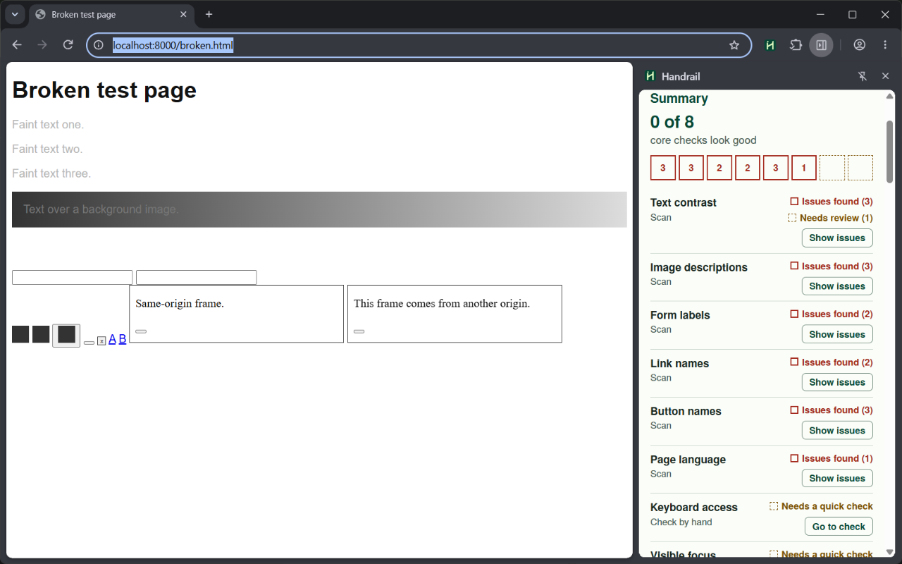

#  Handrail

Handrail is a Chrome extension that checks the page you're working on for accessibility problems and walks you through the checks a scanner can't make.



## What it does

- **Scan.** Click the toolbar icon (or press Alt+Shift+K), then select **Scan this page**. Handrail runs [axe-core](https://github.com/dequelabs/axe-core) on the page, including frames from the same site and open shadow roots.
- **The Core 8.** Eight checks that catch the most common problems: text contrast, image descriptions, form labels, link names, button names, page language, keyboard access and visible focus. The summary says how many of the eight look good, and **Fix these next** lists what to work on first.
- **Three kinds of result.** _Automated_ results come straight from the scan. _Possible problems_ are things the scan flags but a person has to confirm, like vague link text or alt text that looks like a file name. _Guided checks_ are 23 short checklists, written in plain language, for things only a person can judge. You mark each one **Looks good** or **Has a problem**. Handrail never marks a check as good for you.
- **Show on page.** Outlines the element with the problem on the page, with Copy selector and Copy HTML buttons next to it.
- **Copy report.** Copies a Markdown summary you can paste into an issue or pull request.

Scan again after you fix things, and the summary shows what you fixed and what is new.

## What it doesn't do

- It can't certify a page. Automated checks only find some problems. A clean scan does not mean your page meets WCAG.
- It can't press keys for real. To check keyboard focus it works out the Tab order itself and moves focus with a script. A person still has to check for keyboard traps and how custom controls respond to keys.
- It can't reach inside frames from other sites or closed shadow roots. The panel lists frames it could not scan, with a link to open each one on its own.
- It checks one page at a time. It doesn't crawl a site.
- It never changes your site.

## Install

**Chrome Web Store:** [Get it here](https://chromewebstore.google.com/detail/handrail-accessibility-ch/jmmjkdjfbpieoggapbadinapgabkjgof).

**From source:**

1. Download or clone this repository.
2. In Chrome, go to `chrome://extensions` and turn on **Developer mode**.
3. Select **Load unpacked** and choose the `extension/` folder.

Handrail needs Chrome 116 or newer. To scan files on your computer (`file://` addresses), open **Details** for Handrail on `chrome://extensions` and turn on **Allow access to file URLs**.

## How to use it

1. Open the page you want to check. Local servers like `http://localhost:3000` work.
2. Click the Handrail icon in the toolbar, or press **Alt+Shift+K**. The side panel opens.
3. Select **Scan this page** and read the summary.
4. Work through **Fix these next**, then the guided checks under **Needs a human check**.
5. Fix things in your code and scan again.

Chrome only lets Handrail read a page after you click its icon on that page. If you go to a different site in the same tab, the panel asks you to click the icon again.

## WCAG coverage

Handrail targets WCAG 2.2 Level A and AA. The criterion names and levels below come from the [W3C Recommendation, WCAG 2.2](https://www.w3.org/TR/WCAG22/), dated 12 December 2024, read from W3C's machine-readable version at <https://www.w3.org/WAI/WCAG22/wcag.json>. They are kept in [`extension/data/wcag22.json`](extension/data/wcag22.json), and a test checks every reference against that file.

| Check                                                    | WCAG 2.2 success criterion                                                                                                                                                                               | Level | How it is checked |
| -------------------------------------------------------- | -------------------------------------------------------------------------------------------------------------------------------------------------------------------------------------------------------- | ----- | ----------------- |
| Text stands out clearly from its background (Core 8)     | [1.4.3 Contrast (Minimum)](https://www.w3.org/WAI/WCAG22/Understanding/contrast-minimum.html)                                                                                                            | AA    | Automated         |
| Images have a text description (Core 8)                  | [1.1.1 Non-text Content](https://www.w3.org/WAI/WCAG22/Understanding/non-text-content.html)                                                                                                              | A     | Automated         |
| Form fields have labels (Core 8)                         | [4.1.2 Name, Role, Value](https://www.w3.org/WAI/WCAG22/Understanding/name-role-value.html)                                                                                                              | A     | Automated         |
| Links have text that screen readers can read (Core 8)    | [2.4.4 Link Purpose (In Context)](https://www.w3.org/WAI/WCAG22/Understanding/link-purpose-in-context.html), [4.1.2 Name, Role, Value](https://www.w3.org/WAI/WCAG22/Understanding/name-role-value.html) | A     | Automated         |
| Buttons have names that screen readers can read (Core 8) | [4.1.2 Name, Role, Value](https://www.w3.org/WAI/WCAG22/Understanding/name-role-value.html)                                                                                                              | A     | Automated         |
| The page says which language it is in (Core 8)           | [3.1.1 Language of Page](https://www.w3.org/WAI/WCAG22/Understanding/language-of-page.html)                                                                                                              | A     | Automated         |
| Everything works with just a keyboard (Core 8)           | [2.1.1 Keyboard](https://www.w3.org/WAI/WCAG22/Understanding/keyboard.html)                                                                                                                              | A     | Partly automated  |
| You can always see where the keyboard focus is (Core 8)  | [2.4.7 Focus Visible](https://www.w3.org/WAI/WCAG22/Understanding/focus-visible.html)                                                                                                                    | AA    | Partly automated  |
| Focus never gets stuck                                   | [2.1.2 No Keyboard Trap](https://www.w3.org/WAI/WCAG22/Understanding/no-keyboard-trap.html)                                                                                                              | A     | By a person       |
| Tab order follows the page in a sensible order           | [2.4.3 Focus Order](https://www.w3.org/WAI/WCAG22/Understanding/focus-order.html)                                                                                                                        | A     | Partly automated  |
| There is a way to skip repeated navigation               | [2.4.1 Bypass Blocks](https://www.w3.org/WAI/WCAG22/Understanding/bypass-blocks.html)                                                                                                                    | A     | Partly automated  |
| Links make sense in their context                        | [2.4.4 Link Purpose (In Context)](https://www.w3.org/WAI/WCAG22/Understanding/link-purpose-in-context.html)                                                                                              | A     | Partly automated  |
| Image descriptions are actually useful                   | [1.1.1 Non-text Content](https://www.w3.org/WAI/WCAG22/Understanding/non-text-content.html)                                                                                                              | A     | Partly automated  |
| Headings, lists, and tables are marked up properly       | [1.3.1 Info and Relationships](https://www.w3.org/WAI/WCAG22/Understanding/info-and-relationships.html)                                                                                                  | A     | Partly automated  |
| Color is never the only way to show something            | [1.4.1 Use of Color](https://www.w3.org/WAI/WCAG22/Understanding/use-of-color.html)                                                                                                                      | A     | Partly automated  |
| Text can be enlarged to 200% without breaking            | [1.4.4 Resize Text](https://www.w3.org/WAI/WCAG22/Understanding/resize-text.html)                                                                                                                        | AA    | By a person       |
| The page fits a narrow screen without sideways scrolling | [1.4.10 Reflow](https://www.w3.org/WAI/WCAG22/Understanding/reflow.html)                                                                                                                                 | AA    | By a person       |
| Videos with sound have captions                          | [1.2.2 Captions (Prerecorded)](https://www.w3.org/WAI/WCAG22/Understanding/captions-prerecorded.html)                                                                                                    | A     | Partly automated  |
| Moving or blinking content can be paused                 | [2.2.2 Pause, Stop, Hide](https://www.w3.org/WAI/WCAG22/Understanding/pause-stop-hide.html)                                                                                                              | A     | Partly automated  |
| Sticky bars don't cover the focused item                 | [2.4.11 Focus Not Obscured (Minimum)](https://www.w3.org/WAI/WCAG22/Understanding/focus-not-obscured-minimum.html)                                                                                       | AA    | Partly automated  |
| Buttons and links are big enough to tap                  | [2.5.8 Target Size (Minimum)](https://www.w3.org/WAI/WCAG22/Understanding/target-size-minimum.html)                                                                                                      | AA    | Partly automated  |
| Anything you drag can also be done with a click or tap   | [2.5.7 Dragging Movements](https://www.w3.org/WAI/WCAG22/Understanding/dragging-movements.html)                                                                                                          | AA    | By a person       |
| Help is in the same place on every page                  | [3.2.6 Consistent Help](https://www.w3.org/WAI/WCAG22/Understanding/consistent-help.html)                                                                                                                | A     | By a person       |
| People don't have to re-enter the same information       | [3.3.7 Redundant Entry](https://www.w3.org/WAI/WCAG22/Understanding/redundant-entry.html)                                                                                                                | A     | By a person       |
| Logging in doesn't depend on memory or puzzles           | [3.3.8 Accessible Authentication (Minimum)](https://www.w3.org/WAI/WCAG22/Understanding/accessible-authentication-minimum.html)                                                                          | AA    | By a person       |
| Form errors are described in text                        | [3.3.1 Error Identification](https://www.w3.org/WAI/WCAG22/Understanding/error-identification.html)                                                                                                      | A     | By a person       |
| Form fields have clear labels and instructions           | [3.3.2 Labels or Instructions](https://www.w3.org/WAI/WCAG22/Understanding/labels-or-instructions.html)                                                                                                  | A     | Partly automated  |
| Custom controls tell assistive tech what they are        | [4.1.2 Name, Role, Value](https://www.w3.org/WAI/WCAG22/Understanding/name-role-value.html)                                                                                                              | A     | Partly automated  |
| Updates like 'Saved' or 'Item added' are announced       | [4.1.3 Status Messages](https://www.w3.org/WAI/WCAG22/Understanding/status-messages.html)                                                                                                                | AA    | Partly automated  |

_Automated_ means the scan decides. _Partly automated_ means the scan flags problems or possible problems, and a person finishes the check. _By a person_ means the panel gives steps to follow.

The scan also runs every other axe-core rule tagged for WCAG 2.0, 2.1 and 2.2 at Level A and AA. Those results appear under **Other issues**. axe-core's best-practice rules appear separately, marked as not WCAG failures.

## Privacy

Everything runs in your browser. Handrail makes no network requests, has no analytics or accounts, and saves only a page address and your check results. See [PRIVACY.md](PRIVACY.md).

## Development

You need Node.js 22.2 or newer, and Python 3 for the end-to-end tests.

```sh
npm install
npm test          # unit tests, then end-to-end tests in a real Chrome window
npm run build     # builds dist/handrail-<version>.zip from extension/
```

- `extension/` is everything Chrome loads, and nothing else. The store zip is built from it.
- `test/unit/` has the unit tests, `test/e2e/` the end-to-end tests, `test/fixtures/` the test pages, and `test/preview.html` a preview of every panel state with mock data.
- `scripts/` has the build and maintenance scripts.
- `docs/testing.md` is the manual test checklist.

## Contributing

See [CONTRIBUTING.md](CONTRIBUTING.md).

## Credits and acknowledgments

Handrail started during my summer 2026 research placement at [the Ability Project](https://ability.nyu.edu/), NYU's interdisciplinary research space on disability and technology, supervised by Daniel Johnston. That's where I learned the WCAG standards this tool is built on.

NYU's [digital accessibility guidance](https://www.nyu.edu/life/information-technology/web-and-digital-publishing/digital-publishing/accessibility.html) helped me decide which checks belong in the Core 8.

Handrail uses [axe-core](https://github.com/dequelabs/axe-core) by Deque Systems (MPL-2.0) and the [TeX Gyre Heros](https://www.gust.org.pl/projects/e-foundry/tex-gyre/heros) typeface by the GUST e-foundry (GUST Font License). Its explanations link to the W3C's WCAG and Understanding documents. See [THIRD_PARTY_NOTICES.md](THIRD_PARTY_NOTICES.md).

Built with help from Claude Code. The research, design and product decisions are mine.

Handrail is an independent open-source project. It is not an official NYU product and is not endorsed by NYU or the W3C.

## License

MIT, by Abdullah Noor. See [LICENSE](LICENSE).
